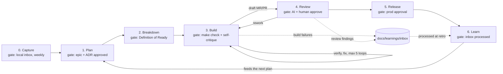
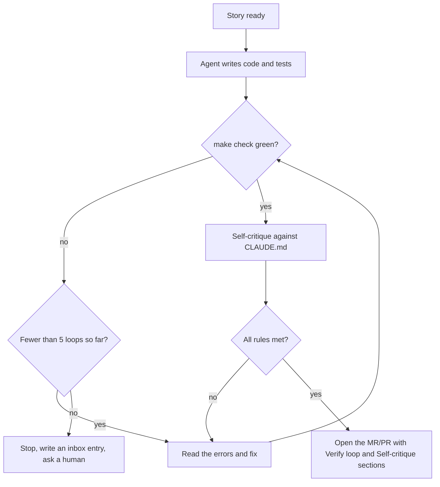
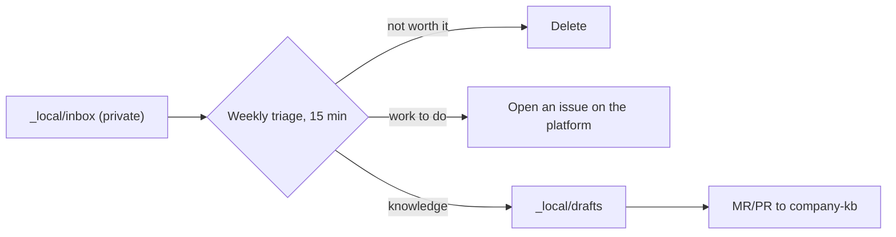
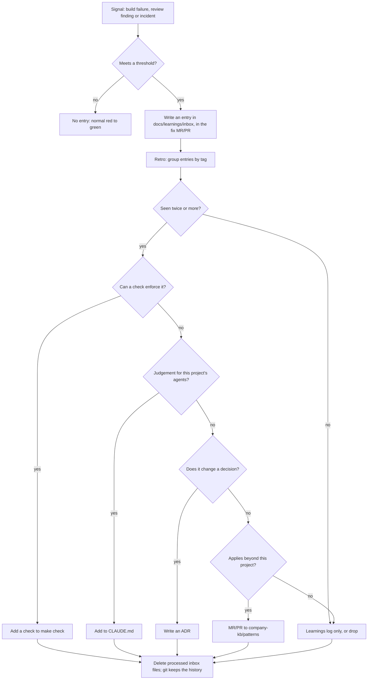
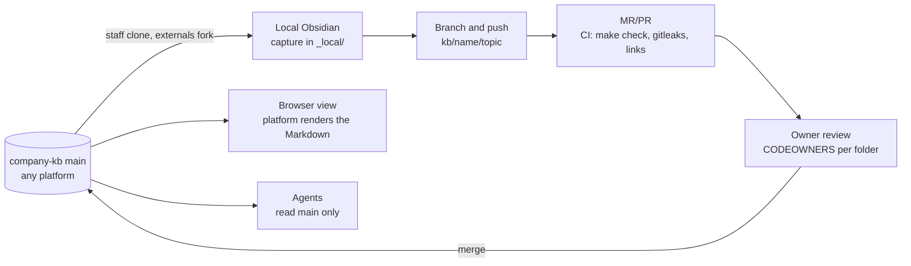

# DevSecOps Workflow with Claude Agents - Proposal v3.2 (flowchart edition)

Version: 3.2 | Updated: 2026-11-27 | Owner: Abner
Source doc: https://claude.ai/artifact/KS2g67skTjJ7xdt5ji3J4r

| Version | Date | Change |
| --- | --- | --- |
| 3.0 | 2026-11-27 | Platform-agnostic (GitLab, GitHub, Gitea), inboxes, Obsidian placement, easy start |
| 3.1 | 2026-11-27 | Version header, dates corrected |
| 3.2 | 2026-11-27 | Markdown exports: plain text and this flowchart edition with Mermaid diagrams (render on GitHub, GitLab and Gitea) |

## What's new in v3

v3 works the same on GitLab, GitHub and Gitea. It also defines exactly where Obsidian folders live and how capture, build failures, review findings and learnings flow through inboxes.

- **Platform-agnostic.** All logic lives in files and in `make check`; the CI files for each platform are thin wrappers. "MR/PR" means a merge request on GitLab or a pull request on GitHub and Gitea.
- **Easy start first.** A day-one version with two repos, one CI job and one `CLAUDE.md`. Everything else is added when the simple version starts to hurt.
- **Inboxes.** Capture is private and local. Build failures, review findings and incidents are team signals, written as files inside the MR/PR that fixes them, and processed in batches at retro.
- **Obsidian placement.** Two vaults per laptop, used at the two ends of the cycle: thinking before, learning after. Tracking stays on the platform.
- **Kept from v2.** CS329A agent principles, the model and effort table, security gates and the company knowledge repo.

## Easy start

Day one is two repos, one CI job, one `CLAUDE.md` and Obsidian on your laptop, on whichever platform the project already uses. The rest of this doc is the target, added piece by piece when the simple version hurts.

| Phase | Set up | Effort | Skipped for now |
| --- | --- | --- | --- |
| **Day 1** | Two repos on the project's platform: `company-kb` and `project-template`. Issues + labels (`type/`, `status/`) + milestones as epics. Protected main. | ~2 hours | Paid epics, boards, bot accounts |
| **Day 1** | Clone `company-kb` and open it in Obsidian with obsidian-git (pull on open). Create `_local/inbox/`. Wikilinks off, so links render on every platform. | ~1 hour | Read-only website: GitLab, GitHub and Gitea all render Markdown in the browser |
| **Day 1** | `Makefile` with `make check` (gitleaks to start). Thin CI files that only call it: `.gitlab-ci.yml` and `.github/workflows/check.yml` (Gitea Actions reads the GitHub syntax). | ~1 hour | Semgrep, Trivy, SBOM, signing |
| **Week 1** | `CLAUDE.md`: stack, "run `make check` and fix until green, max 5 loops", "review your diff against these rules", "log friction in `docs/learnings/inbox/`", 5 dos and don'ts. | ~2 hours | Separate agents, best-of-N, evals |
| **Week 1** | Model defaults: Sonnet 5.5 high for everything; Opus 5.5 for plans, threat models and security review. | 0 | Per-task effort table |
| **Week 1** | Pilot one small epic with Claude Code run locally. One retro at the end that processes the inbox. | the epic | Retro agent, eval set |
| **When it hurts** | Add from below: more scanners (warn first), bot account + deny list, verifier path rule, Passbolt, eval set, read-only site. | per item | - |

## Principles

Workflow rules keep the process safe and traceable on any platform. Agent rules, drawn from Stanford's CS329A seminar on self-improving agents, make agents better over time without making them less safe.

**Workflow rules**

1. **Git is the source of truth.** If it is not in a repo or the platform's tracker, it did not happen.
2. **Platform-agnostic by default.** Logic lives in files and `make check`; platform features are conveniences, never dependencies.
3. **Agents propose, humans decide.** No agent merges, approves its own MR/PR, or holds prod credentials.
4. **Small batches.** One story, one branch, one MR/PR, reviewable in 15 minutes.
5. **Read-only first.** Diagnose and `plan` before `apply`; every risky MR/PR carries rollback steps.
6. **Security is enforced, not requested.** Checks run in CI and block on criticals.
7. **Capture fast, decide later.** Signals go to an inbox without judgement and are processed in batches.
8. **Everything as code.** Infra, pipelines, policies and agent instructions go through MR/PR.

**Agent rules (CS329A)**

9. **Verify before you ask.** The agent loops generate, verify, fix against `make check` until green, max 5 loops, then opens the MR/PR.
10. **A written constitution.** `CLAUDE.md` and these principles are the rubric the agent critiques its own diff against.
11. **Spend compute where it pays.** Low effort for chores, high for building, xhigh and best-of-N only for hard or risky work.
12. **Memory is curated.** Agents read the knowledge repo and project learnings; only merged text becomes memory.
13. **Measure, don't guess.** A regression set of past tasks runs before any prompt, `CLAUDE.md` or model change merges.
14. **Verifiers are protected.** An agent never weakens a test, rule or threshold to make its own work pass.
15. **Every cycle teaches.** An epic closes only when its inbox is processed and its retro merged.

## Lifecycle v3

Seven stages, each with one gate. Inside Build the agent runs `make check` and fixes its own work up to 5 times. Friction from Build and Review is written to the project inbox, and the retro turns repeated signals into rules.



**Inside Build: the verify loop and self-critique**



| Stage | Output | Gate to move on |
| --- | --- | --- |
| 0. Capture | Note in `_local/inbox/`, later an issue | Weekly triage |
| 1. Plan | Epic (milestone + parent issue) and draft ADR, after reading `company-kb` | Epic approved, ADR accepted |
| 2. Breakdown | Stories with criteria, tasks, security notes | Definition of Ready |
| 3. Build | Code, tests, MR/PR with Verify loop and Self-critique sections; inbox entry if friction | `make check` green, self-critique done |
| 4. Review | Fresh-session AI review + human review; inbox entry for findings a rule could catch | Approvals, zero open criticals |
| 5. Release | Tag, image, deploy dev, qa, prod | Prod approval, rollback tested in qa |
| 6. Learn | Retro file, promotions, `company-kb` MR/PR | Inbox processed, retro merged |

## Where the folders live

Each laptop has two kinds of folder: the company knowledge repo clone (with a private, never-pushed corner), and the project repos (whose `docs/` holds the team's inboxes and learnings). Obsidian opens two vaults: `company-kb`, and the `docs/` folder of the project you're on.

```text
~/vaults/company-kb/            # clone of the shared KB repo, any remote (GitLab, GitHub, Gitea)
  _local/                       # gitignored: private, never pushed
    inbox/                      # raw capture: ideas, links, questions
    drafts/                     # notes being shaped before an MR/PR
  runbooks/  howto/  patterns/  architecture/  glossary/
  templates/                    # note and inbox-entry templates
  CLAUDE.md  CODEOWNERS

~/code/<project>/               # each project repo
  CLAUDE.md  Makefile           # make check = every verifier
  .gitlab-ci.yml                # thin: calls make check
  .github/workflows/check.yml   # thin: calls make check (Gitea Actions reads it too)
  CODEOWNERS
  docs/                         # open THIS folder as a vault, never the whole repo
    adr/
    learnings/
      inbox/                    # team signals: build failures, review findings, incidents
      2026-11-epic-12.md        # retro output
  evals/                        # agent eval cases, added later
```

**Why two places:** your private capture must never leak into a repo, and team signals must never stay on one laptop. `_local/` is gitignored, so only your normal laptop backup covers it. Make it its own private repo if you want history.

## Inboxes: capture, failures, learns

Inboxes separate capturing a signal (fast, no decisions) from acting on it (judgement, in batches). Without them, signals get lost, or one-off noise goes straight into `CLAUDE.md` and makes agents worse.

| Signal | Inbox | Who writes it | Create an entry when | Processed |
| --- | --- | --- | --- | --- |
| Capture: ideas, questions, "we should" | `company-kb/_local/inbox/` (private) | You | Anytime, no judgement | Weekly, 15 min: delete, open an issue, or move to `drafts/` |
| Build failure | `<project>/docs/learnings/inbox/` | The agent, inside its fix MR/PR | Verify loop hit 5, same check failed in 2+ MR/PRs, a human had to step in, or the fix took over 30 min | At epic retro |
| Review finding | `<project>/docs/learnings/inbox/` | The agent addressing the review | A rule could have caught it, any `sec/*` finding, or the same comment in 2+ MR/PRs | At epic retro |
| Incident | `<project>/docs/learnings/inbox/` | Whoever runs the RCA | Always | Postmortem, then retro |
| Learn | `<project>/docs/learnings/<epic>.md` | Retro agent drafts, you approve | Epic or incident closes | Promoted (ladder below) |

**Capture: private inbox, weekly triage**



**Not every red build is a signal.** Red then green inside the verify loop is the loop working. Only friction that repeats or needs a human gets an entry.

**Entry format:** one small file per event, written in the same MR/PR as the fix, so it works on any platform with no API calls.

```markdown
---
type: build-failure        # build-failure | review-finding | incident
date: 2026-11-27
ref: "!45 or #45"          # the MR/PR
story: "#123"
check: semgrep
tags: [sql, api]
---
What failed:
Root cause:
Fix:
Could a rule catch this earlier? yes/no + how
```

**At retro**, the agent groups inbox entries by `tags`. Anything seen twice or more is promoted to the strongest place that can hold it, then the processed files are deleted (git keeps the history):

1. **CI rule** in `make check` (strongest)
2. **`CLAUDE.md`** dos and don'ts
3. **ADR**, if it changed a decision
4. **`company-kb/patterns/`**, if it applies beyond this project (via MR/PR)
5. **Learnings log** only, if it is context rather than a rule

**Team signals: from failure to rule**



Once the eval set exists, any agent mistake that a human fixed also becomes a new eval case.

## Obsidian in the workflow

Obsidian is worth it as the editor for Markdown that already lives in git. It is free, takes about an hour to set up, and is strongest at the two ends of the cycle. Tracking, builds and reviews stay on the platform and in the IDE.

| Stage | Obsidian's role | Result ends up in |
| --- | --- | --- |
| 0. Capture | Quick notes in `_local/inbox/` | An issue on the platform, link pasted back into the note |
| 1. Plan | Draft the ADR next to related notes and runbooks | `docs/adr/` via MR/PR |
| 2. Breakdown | None | Issues |
| 3. Build | Read runbooks and patterns | Code in the IDE + Claude Code; failure entries written by the agent |
| 4. Review | None | MR/PR; review-finding entries written by the agent |
| 5. Release | Follow and update the runbook | `company-kb/runbooks/` via MR/PR |
| 6. Learn | Read the inbox, edit the retro, promote patterns | `docs/learnings/`, `company-kb/patterns/` |

**Setup:** two vaults (`company-kb`, and the project's `docs/`). Plugins: obsidian-git (pull on open) and core Templates, nothing else at first. Turn wikilinks off so links render on GitLab, GitHub and Gitea.

**The integration that pays off:** a vault is a folder, so Claude Code runs in it directly, with no plugin or MCP server. Useful asks: "turn this week's `_local/inbox/` into issues and drafts", "group `docs/learnings/inbox/` by tag and propose promotions", "list runbooks past their review-by date". The output is a branch and an MR/PR, like any other agent work.

**Not worth it for:**
- Tasks or boards: that splits the source of truth from the platform.
- Forcing it on occasional contributors: the platform's web editor is enough.
- Real-time co-editing: use Claude Docs for drafts with non-git people.

## Company knowledge repo

One `company-kb` repo lives on whichever platform the company standardises on. Staff clone it and push short-lived branches; contractors, clients and anyone outside the team fork it. Everything reaches main through a reviewed MR/PR.



| Who | How they contribute | Can merge |
| --- | --- | --- |
| Staff comfortable with git | Clone, branch `kb/<name>/<topic>`, push, MR/PR | Only folders they own (CODEOWNERS) |
| Occasional contributors | The platform's web editor: edit, commit to a new branch, open the MR/PR | No |
| Contractors and externals | Fork, branch, MR/PR from the fork | No |
| Agents | Branch `agent/kb-<topic>`, MR/PR with sources cited | No, human approval |
| Folder owners | Review and merge for their folder | Yes |

**Rules:**
- Pull before you write; branches live a day or two.
- One repo per confidentiality boundary: no client secrets in `company-kb`.
- `.obsidian/` commits only the approved plugin set.
- CI runs gitleaks and a link check.
- Agents read main only, never branches or `_local/`.

**Three things called "vault", unrelated:**

| Name | What it is | Holds |
| --- | --- | --- |
| Obsidian vault | A local folder of notes, here a clone of `company-kb` | Knowledge. Never secrets. |
| Passbolt | Team password manager; Community Edition is free and self-hosted (SSO/LDAP need a paid edition) | Human passwords |
| OpenBao / HashiCorp Vault | Secrets engine for machines; OpenBao is the open-source fork | App and pipeline secrets, injected at runtime |

A note says *where* a secret lives ("Supabase service key: OpenBao `kv/comurg/api`"), never the secret itself. gitleaks blocks it anyway.

## Self-improving agents (CS329A) in practice

CS329A covers agents that improve through interaction with themselves and their environment. Each technique below becomes something concrete, and none needs a specific platform.

| Technique | What it means here | Day 1? | Guardrail |
| --- | --- | --- | --- |
| Verifiers | Everything in `make check`: tests, linters, gitleaks, later Semgrep, Trivy, policies | Yes | Verifier files owned by humans via CODEOWNERS |
| Learning from tool feedback | Agent runs `make check`, reads errors, fixes, repeats | Yes | Max 5 loops, then stop and log an inbox entry |
| Constitutional self-critique | Agent checks its diff against `CLAUDE.md` before the MR/PR and lists what it checked | Yes | Checklist goes in the MR/PR description |
| Memory | `company-kb` main and project learnings, read at task start | Yes | Only merged, reviewed text |
| Planning | Plan approved before code; long tasks split into checkpoints | Yes | One story per MR/PR |
| Test-time compute | Effort level per task; best-of-N with tests picking the winner | Later | Best-of-N only on `agent/hard` stories |
| Agent evaluation | 20 to 30 past tasks with known-good outcomes, re-run on prompt, `CLAUDE.md` or model changes | Later | Merge blocked if the pass rate drops |

**Verifiers can be fooled:** an agent told to make CI green can do it by deleting a test. Agents never edit tests, CI files, rules or thresholds in the same MR/PR as the code they check.

## Model and effort per task

Day 1 uses two defaults: Sonnet 5.5 at high for everything, and Opus 5.5 for plans, threat models and security review. The full table below is the target once the pilot shows where it matters. Effort ladder: `low` > `medium` > `high` (API default) > `xhigh` > `max`. Use `max` only after `xhigh` has failed.

| Stage | Task | Model | Effort | Best-of-N | Escalate to |
| --- | --- | --- | --- | --- | --- |
| 0. Capture | Triage `_local/inbox/`, label, spot duplicates | Haiku 5.5 | default | No | Sonnet 5.5 `low` |
| 1. Plan | Architecture options, ADR draft (reads `company-kb` first) | Opus 5.5 | high | 2 drafts, you pick | Fable 5.2 `high` |
| 1. Plan | Threat model per component | Opus 5.5 | xhigh | No | Human security review |
| 2. Breakdown | Epic > stories, criteria, tasks | Sonnet 5.5 | medium | No | Opus 5.5 `high` |
| 3. Build | Feature code, IaC, verify loop, self-critique | Sonnet 5.5 | high | Only `agent/hard` | Sonnet `xhigh`, then Opus 5.5 |
| 3. Build | Large refactor or migration | Opus 5.5 | xhigh | 2-3 attempts, tests pick | Fable 5.2 `xhigh` |
| 3. Build | Write a build-failure inbox entry | Same as builder | same | No | - |
| 3. Build | Tests scaffold, docs, commit messages, CI log triage | Haiku 5.5 | default | No | Sonnet 5.5 `low` |
| 4. Review | First-pass review, fresh session | Sonnet 5.5 | high | No | Opus 5.5 `high` |
| 4. Review | Security review (`sec/*`) | Opus 5.5 | xhigh | No | Human approval always |
| 5. Release | Check plan/diff and rollback steps | Sonnet 5.5 | high | No | Opus 5.5 `high` |
| Any | Incident RCA, postmortem draft | Opus 5.5 | xhigh | No | Fable 5.2 `xhigh` |
| 6. Learn | Group inbox by tag, propose promotions | Sonnet 5.5 | medium | No | Opus 5.5 `high` |
| 6. Learn | Turn a learning into a check in `make check` | Sonnet 5.5 | high | No | Opus 5.5 `high` |

The Haiku rows say "default" because the effort docs don't list Haiku as supported. Fable 5.2 carries extra cybersecurity safeguards, so keep it on design work, not attack-style testing.

## Security gates and guardrails

Every check is a target in `make check`, so it runs the same locally, in the agent's verify loop, and in GitLab CI, GitHub Actions or Gitea Actions. Start with gitleaks. Add the rest warn-only, then make criticals blocking.

| When added | Check | Tool | Blocks on |
| --- | --- | --- | --- |
| Day 1 | Secrets (code and `company-kb`) | gitleaks | Any finding |
| After pilot | SAST | Semgrep | Critical / high |
| After pilot | Dependencies, IaC, container image | Trivy (fs, config, image) | Critical |
| After pilot | Verifier integrity: code and its tests, CI files or rules in one MR/PR | CI path rule + CODEOWNERS | Human owner approval |
| Later | SBOM + signing | Syft + Cosign | Must exist |
| Later | Agent eval set | Eval job | Pass rate drops |
| Always | Prod deploy | Protected environment + rollback plan in MR/PR | Manual approval |

**Agent guardrails:**
- A bot account per role once you have more than one agent. Tokens can push branches and open MR/PRs, but never merge.
- A Claude Code deny list for `terraform apply`, `kubectl delete`, the prod context, `rm -rf` and reading `.env`.
- The verify loop is capped at 5.
- Agents never edit verifiers alongside the code they check.
- Text from outside the team (issues, comments, forks) is untrusted input.

## Platform mapping

The template repo ships both a `.gitlab/` and a `.github/` folder. Gitea reads most `.github/` files, so two folders cover three platforms. Use only what is in the "agnostic choice" column; paid-tier extras are optional.

| Need | GitLab | GitHub | Gitea | Agnostic choice |
| --- | --- | --- | --- | --- |
| Change request | Merge request | Pull request | Pull request | Call it MR/PR in docs and `CLAUDE.md` |
| CI | `.gitlab-ci.yml` | `.github/workflows/` | Gitea Actions, GitHub syntax | Thin files that call `make check` |
| Epics | Epics (paid tier) | Milestones, parent issues | Milestones | Milestone + parent issue with a task list |
| Labels | Yes | Yes | Yes | `type/`, `status/`, `prio/`, `sec/`, `agent/` |
| Issue / MR-PR templates | `.gitlab/` | `.github/` | `.gitea/` or `.github/` | Ship `.gitlab/` and `.github/` |
| Code owners | `CODEOWNERS` | `CODEOWNERS` | `CODEOWNERS` | One file at repo root; enforcement may need a paid tier on private repos |
| Protected main | Yes | Yes | Yes | No direct push, review required |
| Browser editing | Web editor | Web editor | Web editor | Occasional contributors use it, branch + MR/PR in one step |
| Markdown view | Rendered | Rendered | Rendered | The free read-only view of `company-kb` |

The table reflects common defaults, not a guarantee for every version. Check each platform's docs for the current file locations before writing the template.

## Rollout, open questions, sources

**Rollout**

- [ ] Create `company-kb` and `project-template` on the platform of the first project
- [ ] Template: `CLAUDE.md`, `Makefile` (`make check` = gitleaks), thin `.gitlab-ci.yml` and `.github/workflows/check.yml`, `.gitlab/` and `.github/` templates, `CODEOWNERS`, `docs/learnings/inbox/`
- [ ] Clone `company-kb`, set up the two Obsidian vaults and `_local/inbox/`
- [ ] Pilot one small epic with Claude Code locally: verify loop, self-critique, inbox entries
- [ ] First retro: process the inbox, promote what repeats, write the learnings file
- [ ] Add Semgrep and Trivy warn-only, the verifier path rule and the deny list
- [ ] Build the first 10 eval cases from the pilot; switch criticals to blocking
- [ ] Copy the template to the other projects and platforms

**Open questions**

- Which platform hosts `company-kb` when projects live on GitLab, GitHub and Gitea at once?
- One repo per app plus a shared `platform` repo, or a monorepo?
- Who is the second human reviewer for `sec/*` on a one-person team?
- Passbolt Community Edition (free, no SSO/LDAP) or a paid edition?

**Sources**

- CS329A Self-Improving AI Agents, Stanford: https://cs329a.stanford.edu/
- CS329A course description, Stanford Bulletin: https://bulletin.stanford.edu/courses/2263721
- When does verification pay off? (verifier limits): https://arxiv.org/pdf/2512.02304
- Claude effort parameter: https://platform.claude.com/docs/en/build-with-claude/effort
- Obsidian is free for work: https://obsidian.md/blog/free-for-work/
- Passbolt Community Edition overview: https://itsfoss.com/passbolt-review.md
